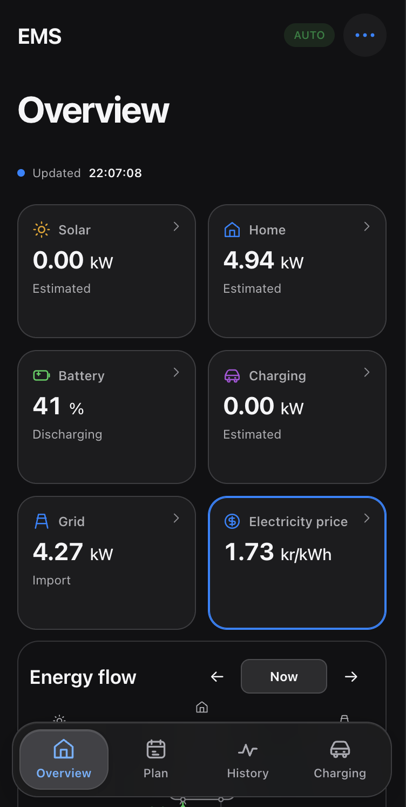
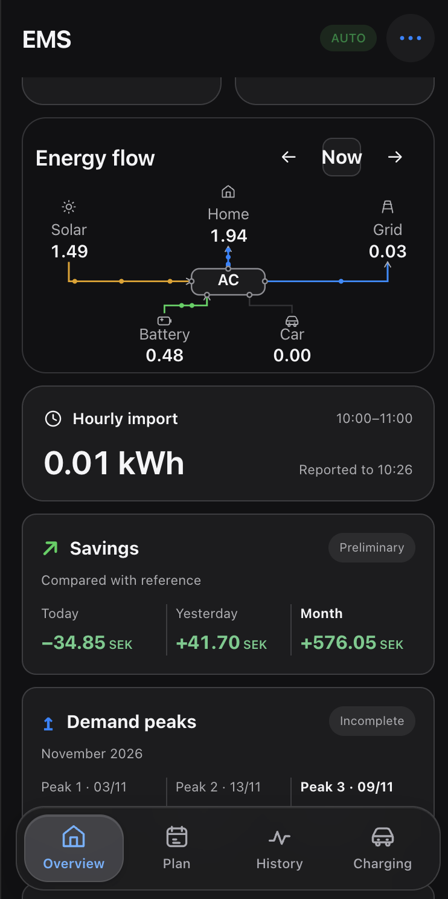
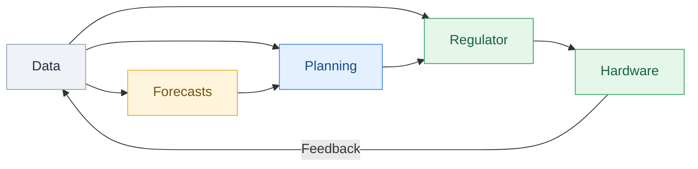
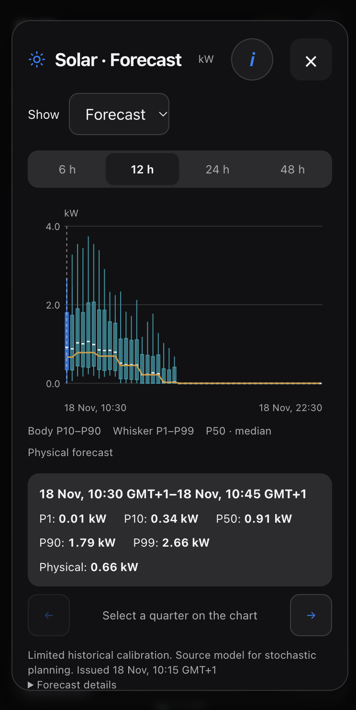
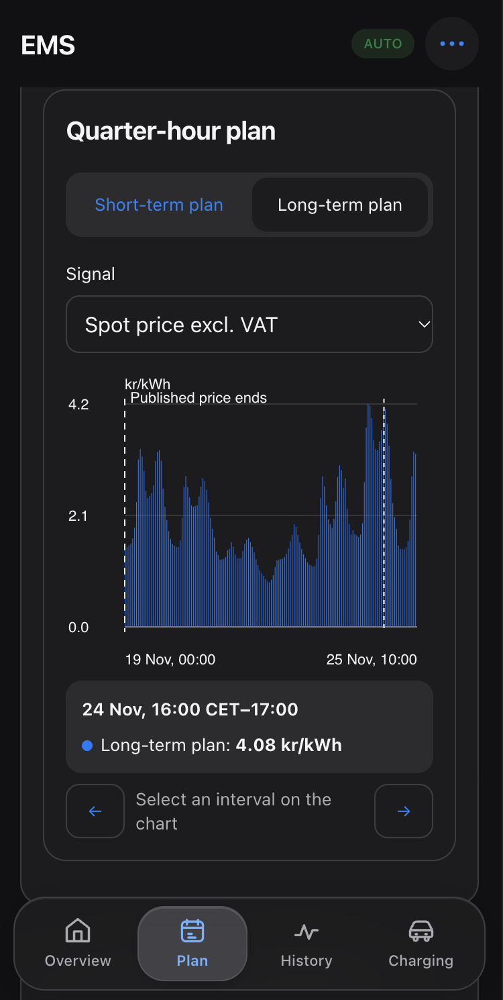

# BEMS

*An autonomous system coordinating solar production, battery storage and EV charging in our home.*

What if your home could optimise its own electricity use?

I'm hardly the first person to ask that question. Plenty of people have asked it before, and plenty have built systems to do exactly that.

The problem? Most of them suck.

So I set out to build something better: the first truly smart one (or smarter at least). And for lack of a better name, I called it BEMS: Building Energy Management System.

  

*The actual BEMS dashboard, 18 November 2026.*

## Why another energy management system?

Most smart energy systems aren't nearly as smart as they claim to be.

The problem isn't necessarily that they can't optimise electricity use. It's that they're built around a limited idea of what an energy system looks like.

There are countless different inverters, batteries and EV chargers. And that's before you start considering everything else that could be controlled, from underfloor heating to your wine fridge.

Some solutions make things simple by only supporting certain hardware. Others let you connect almost anything, provided you're willing to spend a considerable amount of time figuring out how.

Neither seemed particularly satisfying to me.

I wanted to build a system that could adapt to the installation, rather than forcing the installation to adapt to the system.

The long-term idea behind BEMS is an AI-supervised energy management system that can adapt its software to different hardware, data sources and economic models, without requiring the user to understand any of them. Ideally, you connect your equipment, tell BEMS what matters to you, and it figures out how to make the most of it.

And there's no particular reason why that should stop with homes. 

Imagine a logistics company operating a fleet of electric trucks with a large battery energy storage system. Optimising that installation would require more than electricity prices and weather forecasts. BEMS would need to communicate with the company's internal systems, understand where the trucks are, their planned routes and when they need to leave.

A completely different installation, with completely different requirements. But fundamentally the same problem.

That's what I want BEMS to become.

For now, the system is running in our home, controlling a Solis inverter, a 30.72 kWh battery and a GARO EV charger alongside an 11 kW solar installation. It's still a long way from supporting everything, but it's a start.

## Making it work in the real world

Building an optimiser that looks good on paper is one thing. Getting actual hardware to follow it is another.

Our GARO charger has reported measurements with timestamps **in the future**. Other measurements arrive late or describe different moments, even when they look equally fresh. And an acknowledged command doesn't necessarily mean the equipment has finished responding.

At one point, BEMS mistook its own battery charging for an increase in household consumption. It then reversed the battery while the plan still wanted it to charge.

Not ideal.

Fixing that meant tracing the sequence of commands, readbacks and meter measurements, and changing how the regulator handles transitions between them. A lot of the engineering has looked more like this than like solving a neat optimisation problem.

There have been others: a charger that acknowledges commands before its state catches up, and a numerical failure that broke the optimiser.

## Does it actually save money?

Apparently, yes. At least according to the current estimate.

On **18 November 2026**, the dashboard reported **+576.05 SEK for November** against its reference strategy.

  

*The dashboard labels this **Preliminary**. It is a modelled comparison, not an invoice-verified saving.*

If I extrapolate that to every household in Sweden, the market looks fantastic. Sample size: one house. I'll leave the confidence interval for another day.

## Under the hood

BEMS combines electricity prices, solar and household forecasts, and real measurements to plan battery and EV charging. A long-term planner looks further ahead, a short-term planner makes executable plans, and a separate regulator handles the actual control and feedback.

  
  

*Actual forecasting and planning views. The detailed architecture, including data pipelines, planner boundaries, the regulator and failure handling, will be documented separately.*

## What's next?

Today BEMS works with the equipment in our home. The aim is to make it hardware-independent and simple enough that someone who has never written a line of code can install it themselves.

Connect your equipment, tell BEMS what you want, and let it figure out the rest.

No special hardware ecosystem. No programming required. And (hopefully) a smaller electricity bill.

---

*This is a public documentation project. The production controller and raw household data are not published here.*
