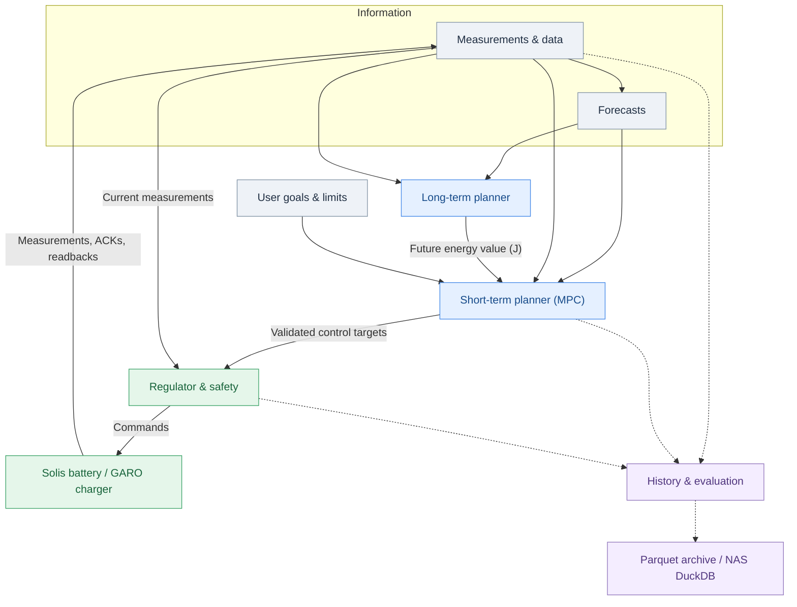

# BEMS — Architecture

*How the system turns uncertain data into decisions, and those decisions into actual electrical power.*

BEMS started as a way of coordinating the equipment in one house: solar panels, a battery and an EV charger. The aim was to minimise the cost of electricity without making the people living there adapt their lives to an optimiser.

That sounds straightforward until you try to control real equipment. Measurements arrive at different times. A command can be acknowledged before its physical effect is visible. A forecast can change while an optimisation is still running. And the mathematically cheapest decision is not necessarily something the inverter can safely do.

This is why BEMS does not consist of one big algorithm. **Data acquisition, forecasting, long-term valuation, short-term planning and physical regulation are separate responsibilities.** Each has its own idea of what constitutes valid input, how quickly it needs to respond and what happens when it fails.

> **Scope.** This describes the existing household implementation and the architecture documented in the source and dated deployment records reviewed in November 2026. It is not a live certification of every running service. A hardware-independent, AI-supervised installation system is the direction of the project, **not a capability already delivered to arbitrary homes or industrial sites**.

## 1. The system at a glance

This diagram intentionally shows **data going directly to the regulator**. The regulator cannot simply follow an old plan and hope the house still looks the way it did when the plan was calculated. Planning tells it what to aim for; current measurements determine what is safe and possible now.

There are also two separate loops. The **decision loop** replans as information and forecasts change. The **control loop** follows an accepted target, watches actual feedback and can stop or fall back without waiting for a new optimisation. The archive observes both loops; it is not in the path of a physical command.

## 2. Measuring a house is harder than it sounds

BEMS does not treat every number from an API as a measurement of the same quality. A reading needs a defined signal, a unit, a sign convention, a source and an explanation of when it was observed and when it became available. These distinctions matter when combining a grid meter, inverter, charger and Home Assistant data.

A useful example is reconstructing the remaining household load from measurements at the same AC boundary:

$$
P_{\mathrm{house}} = P_{\mathrm{import}}-P_{\mathrm{export}}+P_{\mathrm{solar,AC}}-P_{\mathrm{battery,AC}}-P_{\mathrm{EV}}
$$

Here **positive battery AC power means charging**. This equation is only valid when the components refer to the same electrical boundary and compatible physical moments. Substituting battery DC power or mixing timestamps can create an entirely fictitious change in household consumption. Missing or untrustworthy components are not silently replaced with zero.

BEMS consequently keeps track of several times for a single value: the claimed observation time, the time it arrived, and the time it was actually used for a decision. A timestamp is not necessarily proof of when the hardware sampled the value. Our GARO charger has, for example, reported timestamps in the future. Different devices also have different reporting delays, even when their data appears recent.

The platform uses a signal registry, versioned source mappings, explicit units and quality information to make this manageable. Timestamps are normalised to UTC, while electricity-tariff rules still require the correct local calendar and daylight-saving transitions. For forecasting and evaluation, the important question is not merely *what data exists*, but *what data was available at the moment the decision was made*.

## 3. Forecasting: several possible futures, not a promise

The planner needs to know more than the present price and battery state. It depends on expected household demand, solar production, electricity prices and vehicle availability or charging requirements.

These inputs come from different models and sources. Solar forecasting combines weather-driven predictions with corrections from available measurements. Household load forecasting uses recorded consumption and relevant context. Price inputs distinguish published market prices from forecasts or explicitly marked fallbacks. A forecast carries its issue time, provenance and validity, not just a sequence of future numbers.

The point is not to pretend that a sufficiently advanced model can predict the future perfectly. Forecasts will be wrong. BEMS therefore preserves their uncertainty and updates its decisions as newer information arrives. This also makes it possible to evaluate a forecast without accidentally using information that was only known later.

A useful architectural boundary is that **forecast services describe possible futures; they do not issue hardware commands**. Missing or expired forecasts can limit planning, but they do not grant authority to the controller.

## 4. Long-term planning: energy has a value tomorrow

A purely short-term optimiser can make perfectly sensible decisions within its horizon and still be economically wrong. It might empty the battery before an expensive morning, fill it before a sunny day or allocate energy without considering a future EV departure.

The long-term planner studies a wider horizon — up to seven days in the documented implementation — using scenarios for uncertain demand, production and prices. Rather than forcing the short-term solver to repeat every distant calculation, it can provide a **future-cost surface**, conventionally called **\(J\)**, over stored energy in the battery and vehicle.

This is the hand-off between the two planners: the short-term MPC remains responsible for executable decisions, while \(J\) tells it that entering the longer-term continuation with more or less stored energy has a future economic consequence.

The future-cost surface is an approximation, not a certificate of the globally best week-long schedule. Computing it is also expensive on a Raspberry Pi. The implementation uses resource guards, cached or checkpointed work, and numerical validation before a surface is accepted. An unavailable or invalid \(J\) must be distinguishable from an infeasible physical plan.

**An example of why that distinction matters:** in November, degenerate interpolation geometry produced an extreme numerical cost and caused a solver error. The response was not to weaken the physical limits. The numerical valuation was rejected and a bounded reserve valuation could be used instead. This separates *bad economics input* from *impossible electrical operation*.

There is continuing work on when the long-term plan and \(J\) should be recomputed. A reviewed hybrid approach would revalidate frequently but run expensive full optimisations less often. That review is a design direction, not evidence that every part of the proposed schedule is active in production.

## 5. Short-term planning: one problem, not three devices

The short-term planner uses **model predictive control (MPC)**. It optimises a rolling sequence of quarter-hour decisions; the documented short-horizon model spans 48 hours. At the next decision point, it can incorporate fresher measurements and forecasts and solve again.

The current joint implementation uses a mixed-integer optimisation model (SciPy/HiGHS). It considers battery charge and discharge, EV charging and grid exchange together. Its objective accounts for the configured purchase/export economics, network charges, equipment losses and future stored-energy value. Physical limits and user requirements are constraints, not decorative preferences.

For instance, "the car needs enough energy by 06:00" is part of the problem the solver must satisfy. If the requirement cannot be met under the actual equipment, connection and grid constraints, BEMS must report the limitation rather than quietly pretending the vehicle will be ready.

Why solve jointly? Charging the car can create the very grid peak the battery is meant to avoid. Charging the battery cheaply can occupy capacity needed for solar production. The right decision for either device depends on what the others will do.

The solver uses future scenarios without allowing future actions to depend on information the controller will not yet have. A valid result must then pass independent checks of its physical and economic accounting before it can be offered for execution. **A solver reporting success is not, by itself, permission to control hardware.**

## 6. The regulator: safety first, control target second

This is the most important distinction in the architecture. The optimiser chooses a target. The **regulator** is responsible for what the physical equipment is actually told to do.

The regulatory decision uses both the current target and fresh measurements. It checks electrical phase limits, battery and inverter capability, state of charge, current grid import and the available hourly import budget. It also needs to know whether BEMS currently has permission to act, whether the plan is still valid and whether another operator has taken control.

Its priorities are deliberately asymmetric:

1. **Safety and authority.** Do not issue an unsafe, unauthorised or insufficiently supported command, regardless of what the optimiser wants.
2. **Follow the control target.** Within those limits, track the approved grid-exchange or energy goal while respecting equipment response, cadence and feedback.

For the Solis inverter, a native controller owns the command path. The execution logic is separated from the optimiser and backed by ownership, plan and feedback checks. GARO charging has its own device-specific supervision and command conditions; it is not simply an identical copy of the battery control loop.

Three events that are easy to confuse are intentionally kept separate: **command acknowledged**, **device setting read back**, and **physical power measured**. The first does not prove the second, and neither alone proves the third. Commands can be delayed; power can take time to settle; measurements from different devices can describe slightly different moments.

That matters in practice. In one battery-control incident, BEMS briefly interpreted the battery's own charging as a change in house load and reversed its action while the plan still wanted charging. The correction had to address the timing and transition model, not the economic objective.

On failures, there is no universal rule to "just keep the last command". Depending on the fault and evidence available, the controller may retain a bounded, previously confirmed target, move to a neutral state, or relinquish control to a confirmed device-native mode. A new valid plan also does not automatically overrule manual ownership or missing physical authority.

## 7. Storage: operational state is not the research archive

BEMS uses several kinds of storage because they solve different problems.

| Layer | Purpose | Critical to live command execution? |
| --- | --- | --- |
| **Operational SQLite/WAL stores** | Measurements, forecast issuances, settings, plan generations, control events and related journals | Relevant services use their own live stores and contracts |
| **Pi archive exporter** | Finalises UTC-day evidence, preserves source records and publishes Parquet with manifests and checksums | No; it reads the operational sources without owning actuation |
| **NAS archive + DuckDB** | Read-only exploration, long historical queries, evaluation and model-development datasets | No; its availability must not be required for each control decision |

The archive pipeline takes source-identified data from the Pi, produces time-bounded Parquet and compressed original records, and transfers completed exports to a Synology NAS. Immutable manifests and receipts make it possible to tell what arrived and what is still uncertain. The research archive contains additional historical weather, production, consumption and price datasets, sometimes with different timestamps or granularity. They should not be concatenated without checking their provenance and units.

The NAS provides a read-only DuckDB-backed SQL interface for analysis. This is where deeper replay, training datasets, forecasting experiments and long-term evaluation become practical. **DuckDB is not in the battery control loop.** A NAS outage should not become a reason for the inverter to stop following an otherwise valid and safe local plan.

## 8. Why it is built this way

A number of incidents have shaped the boundaries more than the initial design did:

| Real problem | What the architecture needs to do |
| --- | --- |
| Future-dated or delayed charger measurements | Preserve source and receipt times; qualify telemetry before it influences a decision |
| Battery charging misclassified as household demand | Respect the AC measurement boundary and the timing of control transitions |
| Plans becoming stale or replacement plans failing | Explicit plan validity, bounded hand-off and native-safe fallback behaviour |
| An invalid numerical \(J\) breaking optimisation | Separate economic representation errors from actual infeasible constraints |
| Commands acknowledged before hardware catches up | Keep ACK, readback and delivered power as different pieces of evidence |
| Limited Pi CPU, RAM and I/O | Budget heavy forecasting and valuation work separately from time-sensitive control |

These were not just bugs to make disappear. Each exposed an assumption that was reasonable in a simulation but unreliable in a running system. The architecture is partly a record of removing those assumptions.

## 9. What can be generalised — and what cannot yet

The household prototype works with a specific Solis inverter and battery, GARO charger, a Volvo EV and the surrounding measurements. That does **not** establish compatibility with arbitrary devices, tariffs or installations. Photovoltaic production is observed for planning; merely reading a PV inverter does not make it a controlled actuator.

The longer-term aim is different: an installation-specific interface to equipment, data sources, constraints and economic objectives, with AI helping configure or generate the necessary adaptations. A system for an electric-truck depot, for example, would need more than charger and BESS telemetry. It would need fleet schedules, routing, truck availability and departure energy requirements. The underlying planning problem is related, but the integration and safety case are not automatically transferable.

An AI that adapts an integration must not gain unrestricted authority to rewrite running safety-critical logic. Hardware mappings, electrical constraints and economic models need explicit validation before any generated change can influence physical commands.

The home installation is a working prototype of the **decision-and-control architecture**. Turning it into a genuinely portable platform is the next engineering problem.

---

### Notes on evidence and implementation

This document is based on BEMS implementation and dated engineering records reviewed in November 2026, not on a fresh live-system audit. It deliberately distinguishes implemented household functions from the hardware-independent product vision. Actual command dispatch still depends on the owner's current mode, permissions, hardware measurements and deployed service versions.

Selected implementation areas in the private development repository include `bems/ems/` (forecast inputs, joint MPC, planning validation and economics), `bems/longterm/` (long-horizon planning and terminal valuation), `bems/pipeline/` (native measurement and control boundary) and the separate archival deployment. These are technical reference points, not publicly accessible source links.

[Back to README](../README.md)