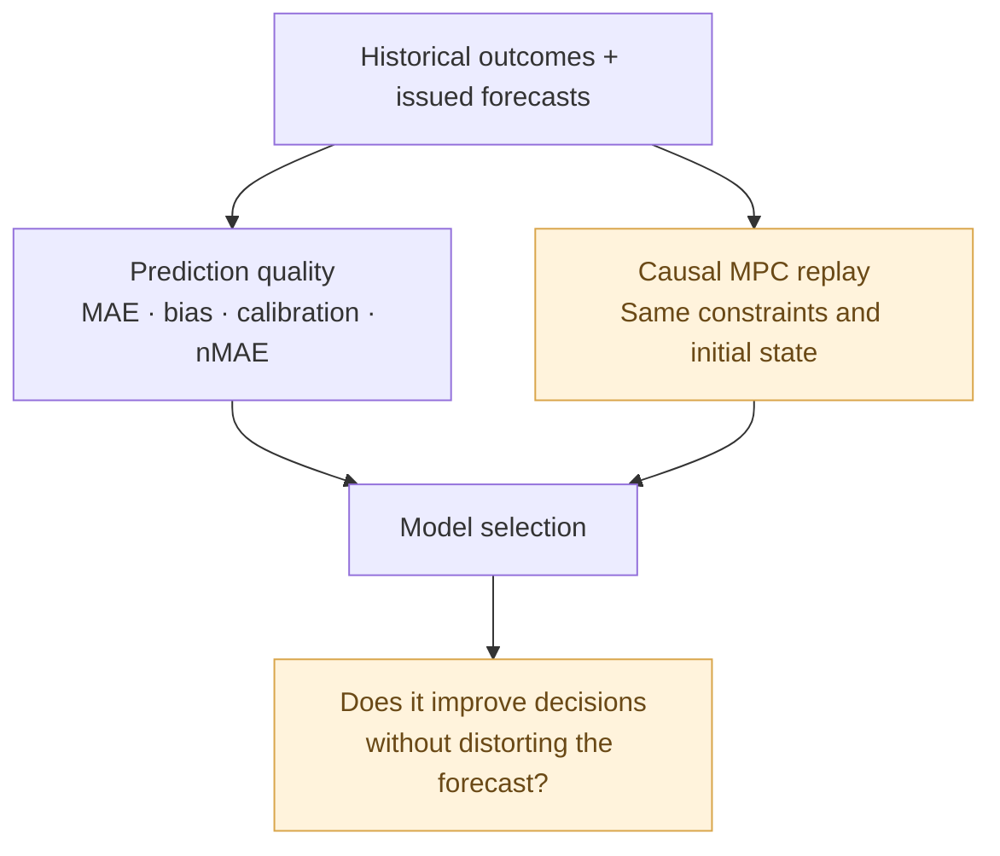
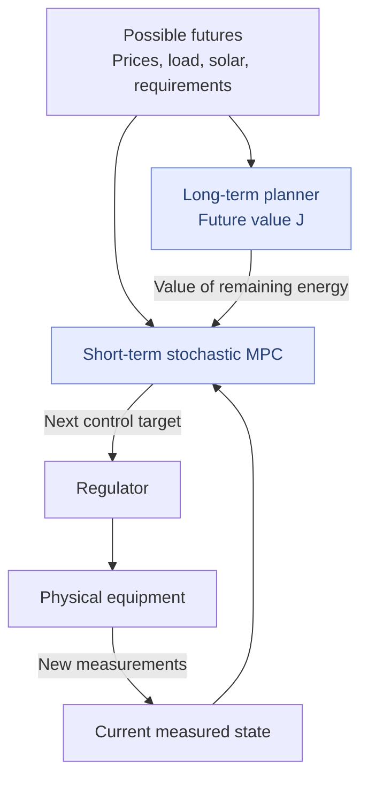

# BEMS: Architecture

*One optimisation platform. Whatever the installation looks like.*

[← Back to BEMS](../README.md)

The [README](../README.md) describes what I'm trying to build: an energy management system that adapts to its installation instead of making the installation adapt to it. That raises a fairly obvious question: how do you design one optimiser for a house, a warehouse and potentially a fleet of electric trucks?

The answer isn't to write a separate optimiser for every battery or charger. **Separate what the equipment is, what we expect to happen, what we'd like to achieve and what the hardware can safely do.**

Our home is the first real installation. **BEMS Next** is the modular redesign being developed and tested separately. It already explores generic resource models and an independent safety process, but it is **not yet a production-ready universal controller**.

## The installation is a model, not a collection of brand names

A battery, EV charger, heat pump and industrial BESS each have different internal dynamics. But the optimiser doesn't need to know their manufacturers. It needs contracts describing their capabilities, energy flows, limits, states and control interfaces.

A site also needs an explicit electrical topology, economic model and set of objectives. This is important: adding another charger is not just adding another button. It might share a phase, a fuse, a transformer or a contractual import limit with everything already installed.

BEMS Next uses versioned site manifests, capability-based drivers and composable models for batteries, EV charging and thermal storage in its offline environment. The ambition is to make the same core usable for different sites and economic arrangements. Supporting a new physical device still requires verified integration and safety behaviour.

## Forecasting: the best prediction might not have the lowest error

This turned out to be one of the more interesting problems in BEMS.

It's tempting to choose the model with the lowest mean absolute error (MAE). After all, a forecast that is wrong by fewer watts should make the controller smarter. Except **not every watt of error matters equally**.

Imagine overestimating solar production by 500 W on a bright summer day when the battery is full and the house is already exporting electricity. It may barely affect the decision. The same 500 W error on a dark winter day, when nearly every available watt could replace expensive grid imports, may change whether the optimiser charges the battery or saves its remaining energy. Timing matters too: an error during an expensive peak hour can matter much more than the same error at 3 AM.

A fixed rule saying “winter matters more” is still an approximation. The real consequence depends on the battery's state, available flexibility, future prices, deadlines and whether the error changes a binding constraint.

### Why ordinary error metrics can mislead

MAE weights every evaluated watt of error equally. Summer, with much more solar production and more opportunities for large errors, can dominate the average even when winter decisions are economically more sensitive.

Normalised MAE (**nMAE**) doesn't automatically solve that. It depends on what we normalise by:

- Normalising by installed PV capacity gives a comparable percentage of rated power, but may still hide how consequential scarce winter energy is.
- Normalising by actual production can make errors explode on very low-production days, and becomes ill-defined at zero.
- Weighting by electricity price or estimated energy scarcity gets closer to the objective, but neither captures the entire downstream decision problem.

Household load is even harder. Cooking, heating, hot water and other loads don't reliably follow a smooth curve. **A good total-load forecast is not necessarily a good phase-load forecast.** A 6 kW load may be harmless when distributed across three phases, but exceed the limit of one phase if concentrated there. Some installations are constrained by a particular phase or branch, not by their total kW. Missing electrical topology cannot be fixed by simply training a larger model.

### The loss-function trap

The obvious next idea is to train a forecast on economic loss rather than prediction error. We've tried versions of this with solar forecasts, including price-weighted and asymmetric objectives. That exposed a different problem: **a forecast can look economically better because it compensates for mistakes elsewhere in the system.**

In one limited autumn battery-planning replay, an intentionally false forecast of **zero solar production** actually produced *lower simulated costs* than several more realistic forecasts. In a summer comparison, it was substantially worse. The false forecast had not discovered anything about the weather; it was making the optimiser behave more conservatively under the particular planning model and demand-charge assumptions.

A separate price-weighted training experiment improved its chosen price-weighted error measure, but made some peak-tariff error measures and solar overestimation worse. Improving one surrogate objective had simply moved the error somewhere else.

That is why defining the right loss function is difficult. If we train the prediction model to work around a particular MPC weakness, a later improvement to the planner could make the supposedly better forecast counterproductive. The forecast should describe a credible future; **the planner should decide how cautious to be about that future**.

So I don't want to optimise one metric and declare victory. Forecasts should be checked for accuracy, systematic bias, calibration, different seasons and horizons, and finally their effect on **out-of-sample decisions using the actual planner**. To make that comparison meaningful, a replay must use only the data and forecast versions available at each decision time. Otherwise, hindsight is being disguised as a forecast.

This also explains why BEMS separates physical solar models, statistical corrections, short-term measurement-based adjustments and scenario generation. They solve different problems. BEMS Next has causal forecast-input contracts, but does not yet reproduce the full production forecasting chain.

## Why two planners, and why stochastic optimisation?

A short-term optimiser can make the perfect decision for the next few hours and still get the week completely wrong.

Suppose electricity is cheap tonight. Filling the battery looks sensible. But if tomorrow's solar production could charge it instead, buying electricity tonight may be unnecessary. That solar is not free: using it to charge the battery means giving up potential export revenue. The right decision depends on purchase and export prices, conversion losses, available capacity and future needs. Or perhaps the car must leave early and tomorrow is cloudy. **Energy left in storage has a future value**, and that value changes with the expected future and the current state.

That's why BEMS separates the long horizon from the decisions it actually executes. The household long-term planner looks up to **168 hours ahead** and provides a state-dependent continuation value, `J`. Short-term model predictive control (MPC) uses that value alongside current measurements, near-term forecasts and user requirements. It doesn't have to solve the entire week again every time something changes.

The future isn't one guaranteed trajectory. BEMS therefore uses **stochastic optimisation**: possible outcomes for load, solar and prices, with decisions evaluated across them. The crucial rule is *non-anticipativity*: scenarios that are indistinguishable today must share today's decision. Future actions may differ only after the information that distinguishes those futures actually becomes available.

Each scenario has its own physical energy trajectory and constraints. Expected cost can be combined with downside-risk measures such as CVaR. Hard requirements, such as a vehicle needing sufficient charge at departure, remain constraints that the optimiser cannot sacrifice for a lower average bill.

The household system has a joint MPC and adaptive J. BEMS Next is generalising scenario-based resource optimisation and stored-state values, with real-hardware and complete feature parity still outstanding.

## The regulator doesn't trust the planner blindly

The planner makes an economic proposal. The regulator's priorities are simpler: **1. safety and control authority; 2. tracking the requested target**.

It reads live physical data independently, checks electrical limits, freshness, ownership and command validity, and only then controls the equipment. A command acknowledgement is not the same as a changed setting, and neither guarantees that physical power has already responded. The household controller has encountered exactly these timing problems.

Keeping this separate also means a slow, failed or numerically unstable optimiser does not get to invent physical authority. In Next, planning and the safety authority run in separate processes in the isolated simulation. That architecture still needs device-specific commissioning before it can control new hardware.

## Agent-ready, without giving an agent the keys to the inverter

The long-term goal is for an agent to help adapt BEMS to unfamiliar equipment, electrical layouts and financial models. It might propose a driver, a battery model, a new tariff or an integration with a logistics company's route-planning system.

But an agent-generated integration should not be allowed to immediately send commands to a physical installation. It must pass unit and schema checks, topology validation, reproducible simulation and independent safety review, followed by explicit authorisation for actual actuation.

That is the direction behind BEMS Next: an extensible, **agent-ready** platform rather than software permanently tied to one household.

## What exists today

**BEMS today:** Real household hardware, operational solar/load/price forecasting, joint battery/EV planning, a separate physical regulator and an independent historical archive. Operational state and command journals are separate from the NAS Parquet/DuckDB analysis pipeline.

**BEMS Next:** A generalised architecture with versioned site definitions, modular resource models, scenario planning, simulated safety boundaries and captured-data testing. It is still an isolated development system. It is not yet a fully commissioned replacement for the household controller, let alone a proven industrial BESS platform.

The ambition is much larger than optimising our electricity bill. The present installation is where the assumptions meet reality.

---

*Architecture and research summary based on BEMS and BEMS Next source and studies reviewed on 18 November 2026. The diagrams describe logical responsibilities, not physical wiring or completed universal hardware support.*