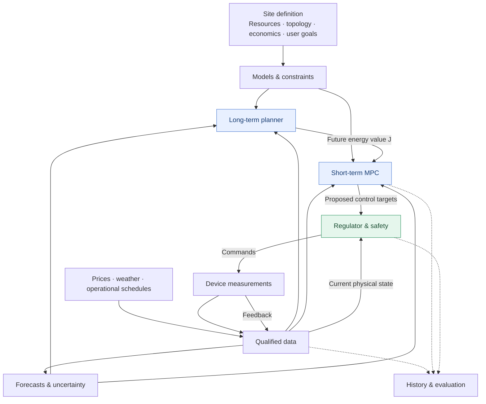
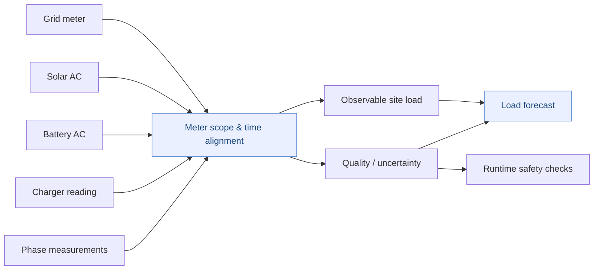
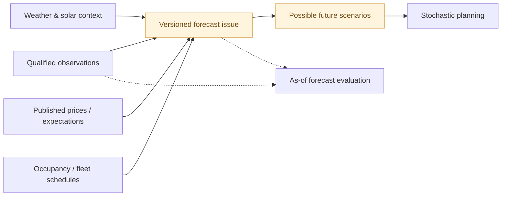
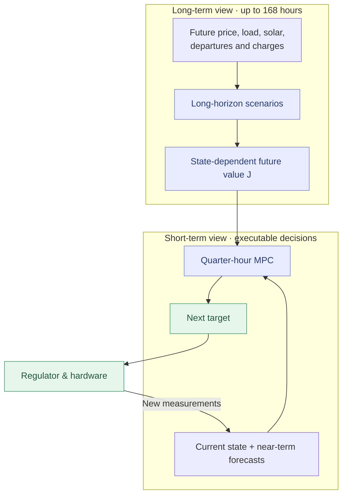
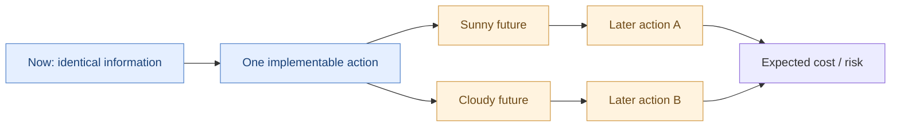
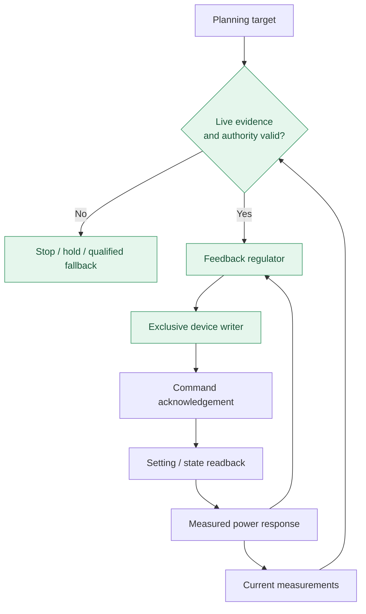
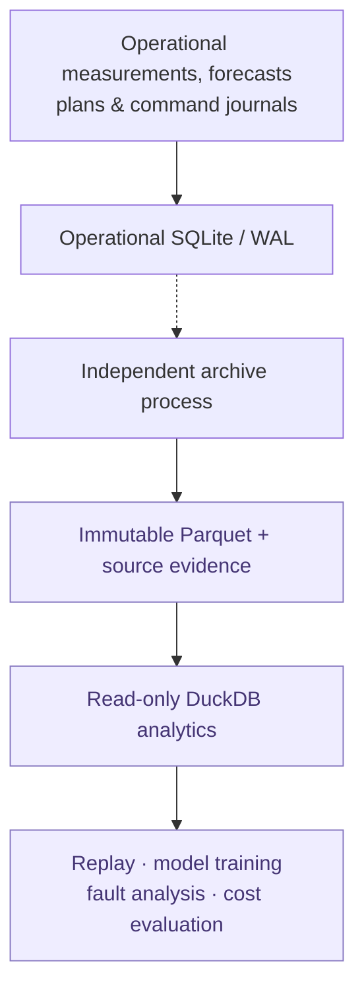
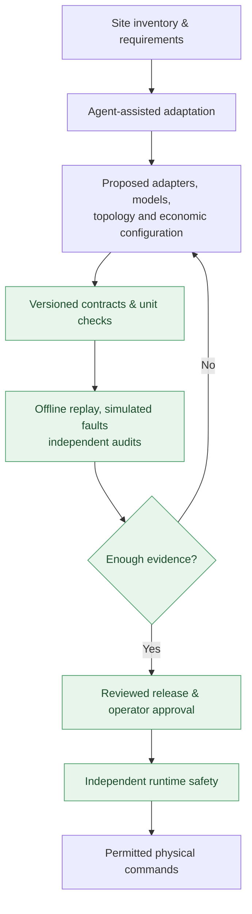

# BEMS — Architecture

*An energy system should adapt to the installation, not the other way around.*

[← BEMS overview](../README.md)

The README explains why I started building BEMS. This document is about what the system needs to look like if the idea is to work beyond our house.

A home battery, underfloor heating and a depot full of electric trucks seem like very different things to control. They are. But they also share the same underlying problem: limited energy, limited electrical capacity, uncertain future demand and a set of requirements that cannot simply be ignored because a cheaper solution exists.

The first BEMS implementation is built for the equipment in our home and operates real hardware. **BEMS Next** is an ongoing attempt to turn the lessons from that installation into a modular architecture: resources, models, integration adapters and economic rules that can change without replacing the entire decision engine.

**Important distinction:** BEMS Next is not currently a production-ready universal controller. Its generic resource and safety contracts have been tested in isolated simulation and captured-data workflows, not commissioned against arbitrary physical devices.

## 1. One system, different installations

I do not want the optimiser to know what brand of inverter is installed. It should know whether there is a storage resource, what energy it contains, which actions are available, how those actions affect the site and what constraints apply.

The installation should be described explicitly rather than hidden inside the code.

| Layer | What changes between installations | What should remain reusable |
| --- | --- | --- |
| Device integration | Protocols, identities, commands, sampling and response times | Typed measurements, capability and feedback contracts |
| Resource models | Battery, EV, thermal storage, flexible load or industrial equipment | Contributed state equations and physical constraints |
| Electrical topology | Meter locations, phase wiring, site import limits, shared branches | Observability checks and site-level power balance |
| Economics | Spot prices, export terms, demand charges, contractual limits, resource wear | A verifiable cost model with well-defined units and priorities |
| Requirements | Car departure, room comfort, truck route, reserve capacity | Explicit deadlines, priorities and feasible operating windows |
| Control | Different devices and failure behaviour | Separate plan validation, authority and safety checks |

That is the core of the future platform. “Works with everything” must eventually mean *there is a safe, testable way to describe and integrate new equipment*, not that a generic API magically makes all equipment interchangeable.

### Logical system

Three responsibilities deliberately remain separate: **understanding what is happening, deciding what would be economical and determining what is safe to execute right now.**

## 2. Data: having a number is not the same as knowing what happened

One of the biggest surprises in the household implementation was how much effort went into measurements.

Our EV charger has reported timestamps in the future. Different devices update at different intervals. Some values describe an interval, while others describe a recent state. A device may acknowledge a command before the corresponding power change is observable.

These are not merely annoying logging details. A regulator can make the wrong decision if two perfectly reasonable measurements refer to different physical moments.

Each measurement therefore needs an identity, unit, source, quality and explicit timing: when the source claims the event occurred, when it became available, and how long it remains valid. Invalid or unavailable data must remain unknown. Treating an unknown value as zero might produce a solvable problem, but not necessarily a safe one.

### Why meter topology matters

A grid meter, battery meter and charger meter may describe overlapping flows. Blindly adding their values can double-count consumption. More generally, a meter represents an equation over underlying physical flows. If those equations are incomplete, some quantities cannot be inferred.

BEMS Next introduces meter-scope topology and observability checks: derive a required flow only when the qualified measurements make it identifiable, otherwise mark it unknown.

**Total power is not the same as phase loading.** Consider an illustrative three-phase site with 16 A available per phase. A 6 kW single-phase load at approximately 230 V could draw roughly 26 A on one phase, even though 6 kW is below the site's approximate combined three-phase capacity. A very accurate total-load forecast would not reveal this.

That matters when a battery, vehicle charger and other equipment share electrical constraints. For some sites the binding limit is not total kW, but a specific phase, branch or transformer. An aggregate forecast divided by three is an assumption, not evidence that power is balanced.

The current household controller has phase-related protections. Next's generic simulation accounts for phase power but is not yet equivalent to a verified physical phase-current, wiring-group and synchronisation safety model.

## 3. Forecasting uncertain demand, not just drawing a nice curve

Forecasting solar production is an obvious part of energy management, but **household demand may be the harder problem**. Occupants are not deterministic; hot-water heating, cooking, appliances and vehicle arrivals create peaks that can move around dramatically. A model that predicts tomorrow's kWh well may still miss the exact hour, or the exact phase, that makes a decision expensive or physically impossible.

There are several questions hiding behind the word “forecast”:

- How much energy will be needed?
- When will that demand occur?
- Which demand is actually flexible?
- How will the load be distributed across phases?
- How confident are we, and how costly would an overestimate or underestimate be?

The answer cannot always be a single number. Some sites may need joint distributions of load, solar and prices; others may have uncertain arrivals or external dispatch schedules. Correlations matter: constructing arbitrary combinations of separately ranked forecasts can create unrealistic futures.

The issue time is part of the data. To replay a decision made on Tuesday, we must use the forecasts **available on Tuesday**. Using Wednesday's improved prediction or actual weather in the Tuesday optimisation would be look-ahead leakage, not performance.

The household BEMS has separate operational solar, load and price pipelines. BEMS Next has typed causal forecast inputs, but its current offline execution still uses experimental or captured issuances; full integration of the trained production models is unfinished.

## 4. Why there is a long-term planner

A short-term optimisation can be locally perfect and globally ridiculous.

If electricity is cheap tonight, charging the battery may look obvious. But if tomorrow is sunny, that stored energy might prevent us from using our own solar production. If tomorrow is cloudy, not charging might be the expensive mistake. Add a required EV departure, a demand charge or a multi-day price pattern, and the best immediate choice depends heavily on what happens later.

The problem is a finite planning horizon. Without a model of what comes after it, the optimiser can behave as though energy remaining at the end of the window has no value.

BEMS separates the long view from the short one. The longer-term planner looks up to **168 hours ahead** in the household architecture, considering future costs and constraints. It produces an approximation of the **future value of stored energy**, commonly called `J`, which the short-term MPC can include at its horizon boundary.

In simplified terms, `J(time, stored state, tariff context)` is the expected future cost of continuing from that state. An additional kWh in the battery may be valuable in one situation and almost worthless in another. Other forms of storage, such as thermal energy, can in principle be valued in the same framework, although the state models are different.

This division is intentional:

1. **Planning frequencies differ.** A meter update should not trigger an expensive full seven-day optimisation. A new day-ahead price publication might.
2. **Time resolution differs.** Near-term decisions need detailed physical and charging constraints. More distant futures can use a coarser description.
3. **Computation is finite.** The controller must keep responding even if long-horizon work is slow, interrupted or numerically invalid.
4. **The failure modes differ.** An invalid future-value approximation must not become an invented physical restriction or stop an otherwise safe actuator.

In the household system, adaptive J has already required resource guards, resumable computation and numerical fallbacks. Next generalises future value to stored-state resources, including battery and thermal models in isolated tests. That work is still an approximation, **not a proof of globally optimal long-term behaviour**, and complete coupled vehicle-storage parity remains unfinished.

## 5. Stochastic MPC: the system cannot know tomorrow's weather

One expected forecast is convenient, but usually too confident.

Suppose two futures are equally plausible: tomorrow is sunny or tomorrow is cloudy. The optimal battery policy might differ after sunrise. But BEMS cannot select this evening's action by looking at which future turns out to be true.

That gives us a crucial mathematical requirement: **non-anticipativity**. Scenarios sharing the same observed history must use the same decision. They may branch only after information actually becomes available.

A stochastic optimiser evaluates the decisions across multiple possible futures. Every scenario needs its own physically consistent trajectory: battery state, conversion losses, grid exchange, phase limits and the consequences of charging choices. The objective can account for expected cost and, where appropriate, the risk of particularly expensive outcomes (for example through CVaR).

**User requirements do not become optional just because the average electricity bill looks better.** The EV's required departure energy, physical limits and other hard obligations take priority over discretionary cost reductions.

The household MPC uses causal stochastic planning concepts. BEMS Next's isolated scenario compiler also implements shared current decisions, scenario-dependent future recourse, expected-cost/CVaR accounting and independent reconstruction. It does **not** mean that 512 scenarios across every possible seven-day, multi-resource site have been qualified, nor that synthetic results demonstrate reliable physical dispatch.

## 6. Short-term MPC: optimise the site, not each device separately

The short-term MPC combines measurements, near-term forecasts, user constraints and the future energy valuation. It plans battery use, charging and grid exchange as one constrained problem.

This prevents separately “optimal” devices from fighting each other. A charger and a battery may share the same phase headroom. Discharging a battery now changes its value tomorrow. Reducing one demand peak may change the cost of another under a monthly tariff.

The planner includes resource state equations, physical power bounds, charging windows, departure requirements, tariff and historical billing context, uncertainty and the future-state value where available. It then produces an **executable candidate plan**. That wording matters: a solver returning success is not enough to authorize physical control.

The plan must be independently checked, and the regulator is responsible for determining whether its current target is still safe under *current* measurements.

## 7. Regulator and authority: safety before economic targets

The planner decides what would be useful. The regulator checks what is permitted and tries to make the hardware follow the plan without violating verified limits.

This is why the regulator consumes live measurement data directly instead of simply trusting the plan that arrived earlier. It enforces two ordered priorities:

**1. Safety, physical limits and control authority.** Do we have sufficiently fresh, consistent measurements and an actual right to command this device?

**2. Control targets.** Within those limits, how closely can we track the planner's request?

A command can be acknowledged while the actual battery is still ramping. If the controller then mistakes that transitional power for a sudden increase in household consumption, it can reverse a valid target. This is a real class of incident encountered in the household installation, not something invented for a diagram.

Plan validity, leases, ownership, physical feedback and actuator timing are consequently separate contracts. Failed optimisation must not give a planner permission to bypass them.

In Next, the planner and safety authority operate in separate processes with simulated ownership, expiry, restart and fault handling. Only emulated transports are currently qualified in that path. **An independent safety process is an architectural advantage; it is not a substitute for real-device commissioning.**

## 8. Economic models are part of the installation

The system should optimise the *actual economic arrangement*, not a universal “electricity price”.

A residential household may pay for hourly energy, export and monthly demand peaks. An industrial site may have contractual demand charges, multiple storage systems, dispatch obligations or fleet-related costs. Some requirements belong in the objective, while others are hard constraints.

The economic model therefore needs explicit tariff definitions, historical billing state, units and independently reproducible accounting. The goal is to make these models replaceable without making the planner or the safety process depend on a particular utility.

The household implementation has a concrete tariff model. Next reuses parts of the existing pricing and demand-charge logic. **Any tariff and any country** is a design ambition, not an implemented compatibility claim.

## 9. Storage: the archive is not the controller

If BEMS is supposed to save money, we should be able to reproduce *why it made a decision*, and determine whether the result was genuinely better than an alternative.

Operational measurements, forecasts, plans, command journals and feedback need to be retained with their versions and timestamps. But a large analytics database must not be required for every physical control decision.

The current BEMS therefore keeps operational SQLite stores and journals separate from an independent archival pipeline. The archive exports immutable time-partitioned data and source evidence to Parquet on the NAS, where DuckDB provides read-only analytical queries.

This pipeline helps distinguish simulated savings, counterfactual savings against a documented baseline and invoice-verified savings. They are not interchangeable claims. It also preserves inconvenient data-quality evidence instead of making history look cleaner than it was.

Next does not yet replace the household archive; its development journals and captured inputs are deliberately isolated from the production control system.

## 10. Agent-ready without letting an agent command the inverter

The long-term ambition is that someone without programming experience should be able to connect their equipment, describe what matters to them and let the system adapt. An AI agent could help recognise protocols, propose integrations, map measurements, define tariffs and construct resource models.

But we cannot take “agent-ready” to mean that an agent can silently rewrite production control code whenever it encounters an unfamiliar charger.

The design principle is that **agents may propose changes; validated software and independently enforced permissions decide what may run**. Installation manifests, versioned driver contracts, capabilities, physics and economic models are the foundation for this. Automated adaptation and safe customer setup remain future work.

Consider the electric-truck depot from the README. BEMS would need route-planning and fleet-management data: which vehicles will return, how much energy they need, when they leave again and how uncertain those schedules are. It could then optimise charger availability, BESS dispatch and site demand together. That is a very different installation, but the same separation between data, forecasting, planning, physical limits and safe execution should still apply.

## 11. What works today, and what is still being built

| Capability | Household BEMS | BEMS Next |
| --- | --- | --- |
| Physical operation | Controls the documented household battery/inverter and EV charger | Isolated simulation and captured-input execution; no live physical commissioning |
| Modularity | Components and safety boundaries developed around one site | Typed site manifests, replaceable models and simulation drivers |
| Forecasting | Operational solar, load and price pipelines | Issued forecast contracts; full production-model parity incomplete |
| Planning | Joint battery/EV MPC and long-horizon energy value | Generic resource composition, causal scenario optimisation and experimental adaptive stored-state values |
| Phase/topology | Household-specific phase limits and measurement contracts | Meter equations and phase-power checks; full native phase/branch safeguards outstanding |
| Safety | Native control, feedback, ownership and fault handling | Independent simulated safety process and validated offline control |
| Analytics | Operational history and independent NAS Parquet/DuckDB archive | Separate simulated journals; no production archive migration |
| Universal site setup | Not supported | Long-term goal, not a shipping capability |

The first installation proves that these are **real engineering problems**, not just a good-looking optimisation diagram. Next asks whether the solutions can be expressed as general contracts instead of becoming an ever-growing collection of house-specific exceptions.

There is more work to do: real vendor transports, broader physical safety models, reliable setup, verified economic flexibility and qualification on actual hardware. I would rather say that clearly than claim the system already works everywhere.

---

*Technical design and implementation status reviewed against BEMS and BEMS Next source on 18 November 2026. Diagrams are logical, not electrical wiring diagrams. Numerical examples are illustrative, not measured installation data.*