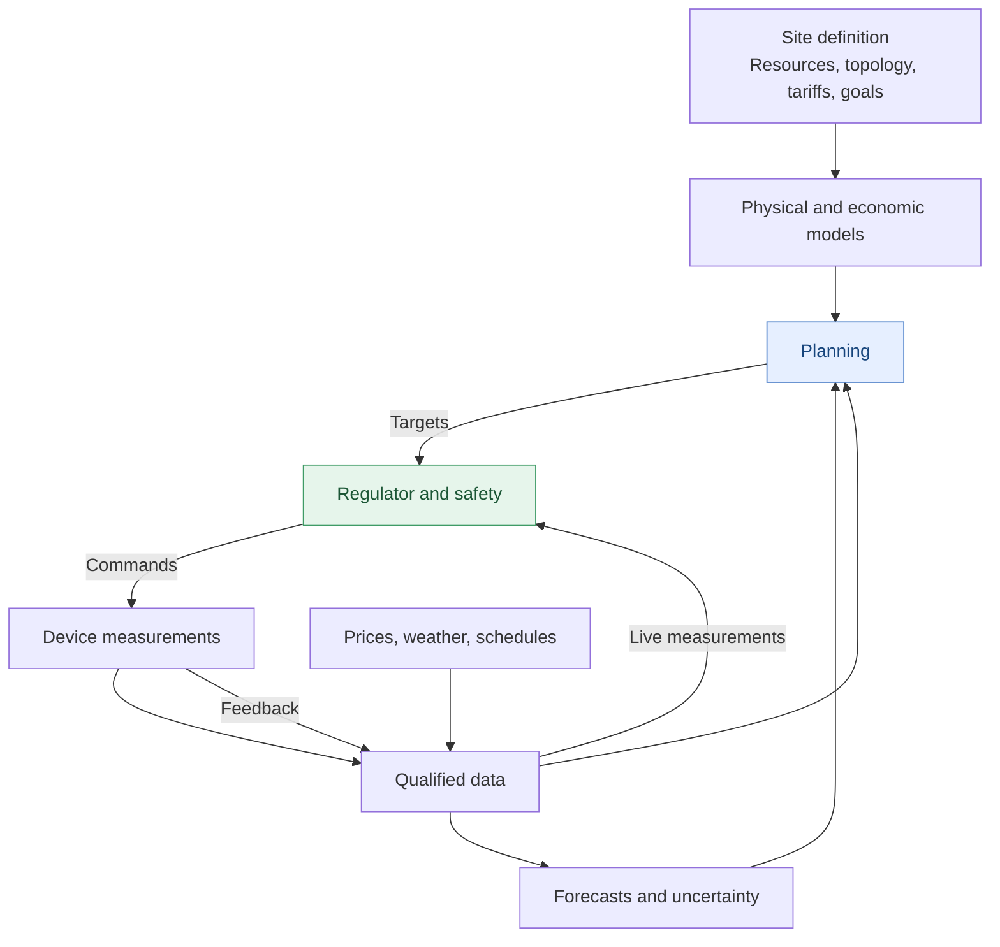
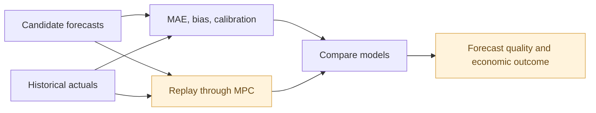
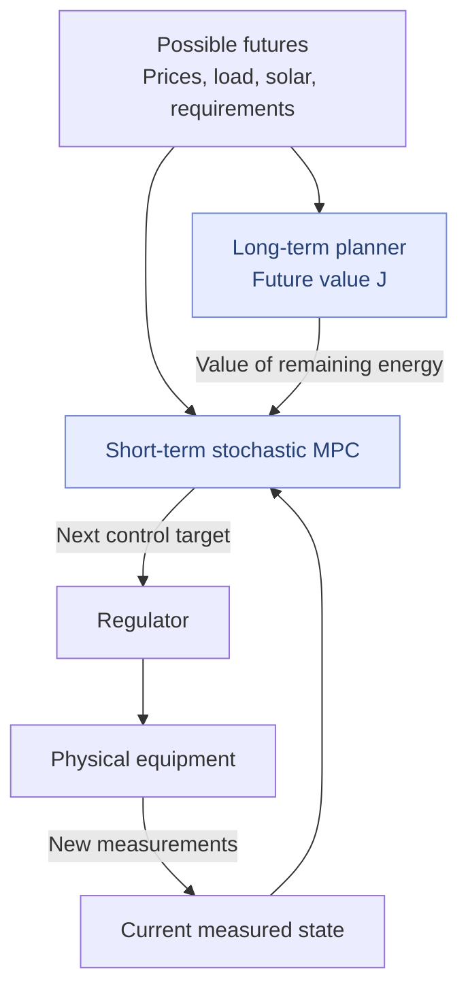
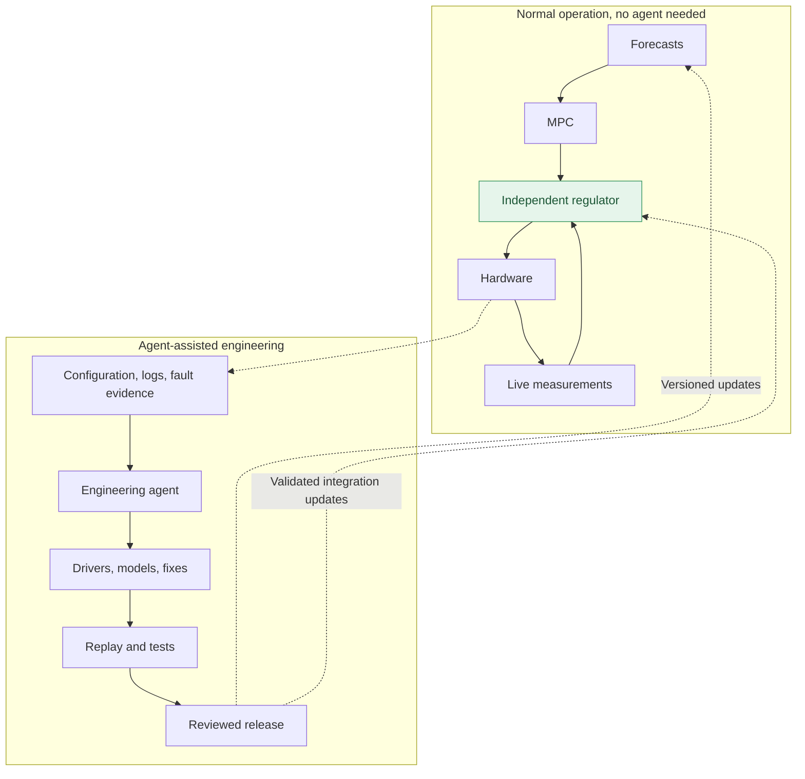

# Architecture

[Back to the README](../README.md)

The README is mostly about what I want BEMS to become. This is how I'm trying to build it.

The system at home already forecasts electricity use and solar production, optimises the battery and EV charging together, looks several days ahead and controls the actual equipment. That part works. The difficult bit now is making the same approach work when the installation looks completely different.

I don't particularly want to maintain one optimiser for Solis, another for a different inverter and a third for some industrial BESS. That gets ridiculous quite quickly.

## Describing the installation

The optimiser needs to know what each resource can do, where it's connected and what we're trying to achieve. It shouldn't need to know which manufacturer made it.

Take an EV charger. Knowing its maximum power is useful, but not enough. Which phase does it use? Does it share a limit with another charger? Can it regulate current continuously, or does it have a minimum power? How long does it take to react? What happens if communication disappears?

Add a second charger without answering those questions and the optimiser might produce a perfectly valid schedule for a completely imaginary electrical installation.

BEMS Next uses versioned site definitions, device capabilities and resource models to describe those things. Batteries, EV charging and thermal storage contribute their own physical constraints to a shared optimisation problem. There are already offline test installations with multiple batteries and chargers, EV-only setups and thermal storage. The point is to change the installation model rather than rewrite the solver every time.

The economic model is installation-specific too. A household spot-price tariff, a network demand charge and a depot with contracted power limits are different problems. They can still use the same planning machinery, provided the costs and constraints are described correctly.

## Forecasting

I originally thought the goal here would be fairly simple: make the most accurate forecast possible and give it to the optimiser.

Turns out that's not quite how it works.

### A smaller error isn't necessarily better

A 500 W error in solar production can be almost irrelevant on a sunny summer day when the battery is full and the house is exporting. It still has an economic cost or opportunity cost, but it might not change what the controller should do.

The same 500 W error during a dark winter day could be much more important. Maybe the battery has little energy left, grid imports are expensive and that missing solar energy changes the decision entirely. Of course, there are summer situations where an error matters a lot and winter situations where it doesn't. The actual question is whether the error changes a decision, and what that decision costs.

This is one reason I don't think selecting models purely on MAE makes sense. The summer usually has more solar production, and therefore more room for large absolute errors. A model can perform well on annual MAE while being worse when electricity is scarce.

nMAE doesn't magically fix this. Normalising by installed solar capacity still doesn't tell us how valuable the energy was. Normalising by actual production can give absurd numbers on days with almost no solar, and is undefined at zero. We've experimented with weighting errors by energy scarcity and electricity prices, which helps, but it's still a proxy for the real problem.

Household load is arguably worse. A house isn't particularly interested in following a smooth load profile. Someone starts cooking, the heating switches on or a car gets plugged in. Predicting the right daily energy is one thing. Predicting the fifteen minutes that set an expensive demand peak is another.

And there's an extra problem: **total load doesn't necessarily tell us which phase is overloaded**. A 6 kW load spread over three phases is very different from 6 kW on one phase. At around 230 V, the latter draws about 26 A. On a site with a 16 A phase limit, the total power forecast can be correct and the proposed control action still impossible. Depending on the installation, phase loading may be the constraint that matters most.

### What should we actually train the model to minimise?

The obvious idea is to use an economic loss function instead of MAE. We tried price-weighted and asymmetric losses for solar forecasting. The results were interesting, and a little annoying.

In one autumn experiment, I deliberately gave the battery planner a forecast of **zero solar production**. It was obviously wrong, but it still produced lower simulated costs than several of the more accurate forecasts. On the summer comparison it performed much worse.

The model hadn't discovered some clever trick about predicting sunlight. The wrong forecast was making the MPC act more conservatively under that particular demand-charge model. Basically, the forecast was compensating for the planner's weaknesses.

That's a fairly dangerous thing to optimise for. Fix the MPC later and your supposedly improved forecast might suddenly become worse. Price-weighted training showed a related trade-off: it improved the metric it was trained for while increasing some peak-period errors and solar overestimation.

There's real room to improve the forecasts, though. In one retrospective test with archived GFS weather, a LightGBM residual on top of the solar physics model reduced scarcity-weighted absolute error from **0.351 to 0.246 kW**, around **30%**. That's a substantial improvement in that metric. It still doesn't tell us how much money the controller would save with it.

So the approach is to evaluate forecasts on their own merits, then test what happens when the real planner uses them. The replay also has to be causal. If I'm evaluating a decision from Tuesday, I can't quietly use a weather forecast that arrived on Wednesday.

We currently use a combination of physical solar models, statistical corrections, recent measurements and scenarios. Different horizons call for different methods. I don't see much reason to insist that a single model should be best at everything.

## Why bother with a long-term planner?

Suppose electricity is cheap tonight. The short-term MPC decides to fill the battery. Fine, unless tomorrow is sunny and we'd rather save room for solar generation.

That solar electricity isn't free. We could potentially sell it instead of storing it, so there's an opportunity cost. But the choice still depends on the difference between buying and selling prices, battery losses, upcoming demand and how much energy we need later.

A short planning horizon has trouble with this because it can't see what happens after its last time step. In the worst case, it treats the end of the horizon as the end of the world.

BEMS therefore has a separate long-term planner looking up to **168 hours ahead**. Its job is to estimate the future economic value of stored energy, represented by a state-dependent function `J`. The short-term MPC uses that value at the end of its own horizon.

That way, we don't need to solve the full seven-day problem every time the regulator gets a new measurement. The long-term work can run separately, with its own computation budget. New day-ahead prices can change the future value enough to justify a new calculation; every small load fluctuation usually doesn't.

## Stochastic optimisation

There is another fairly important detail: we don't actually know what tomorrow will look like.

BEMS uses scenario-based optimisation for possible solar production, household demand and prices. The MPC evaluates decisions across those futures, including how each decision affects the battery state, grid power, charging requirements and costs.

The important part is *non-anticipativity*. If two scenarios have the same information available right now, the controller has to make the same decision in both. It can change its future actions once it actually observes which way things are going. Otherwise we're just letting the optimiser cheat by knowing the future.

We can optimise expected cost and account for expensive outcomes using measures such as CVaR. Physical limits and required EV departure energy still have to be respected. Saving a few kronor by sending someone away with an empty car would be a rather questionable optimisation result.

The household implementation already uses joint stochastic MPC and adaptive future-state valuation. BEMS Next has also implemented causal scenario planning and stored-state valuation with modular resources in its isolated runtime.

## The regulator

The planner gives the regulator a target. The regulator reads the current measurements and decides how to execute it.

There are two priorities. First, keep control within the actual physical and authority limits. Second, follow the plan as well as possible.

That separation has been useful more than once. As mentioned in the README, BEMS once interpreted its own battery charging as extra household load and started reversing the charge. Commands, readbacks and actual power don't necessarily happen at the same moment. Acknowledging a command isn't proof that the battery has already done what we asked.

The regulator deals with measurement freshness, electrical limits, feedback, command ownership and the equipment's response. It must also keep behaving sensibly when the optimiser is slow or fails. BEMS Next makes planning and safety separate processes, and tests those boundaries with simulated faults, expiry and restarts.

## What I mean by agent-ready

I want agents to be able to **write the code that adapts BEMS to a new installation**. Give one the equipment documentation, a description of the electrical system and the requirements, and it should be able to work on the drivers, data sources, resource models and tariff logic.

The other job is dealing with things that go wrong. And with physical equipment, something always does eventually. Firmware changes, a sensor starts reporting nonsense, a command behaves differently than expected. Having an agent investigate a serious fault, reproduce it and prepare a fix seems much more useful than trying to anticipate every possible failure in advance.

This does **not** mean an LLM should decide the battery setpoint every few seconds. That would be a terrible idea. The optimiser and regulator already have mathematical and physical rules for that.

The real-time safety response belongs to the controller. Agents can investigate and improve the system using logs, replay and tests. Their changes go through validation and a controlled release before they affect hardware.

This is already how I think about the split between the normal BEMS control loop and the agent-assisted development work. Fully automatic installation and recovery are still things I'm building towards.

## Where it stands

The household BEMS controls real equipment and combines solar, load and price forecasts with joint battery and EV planning, long-term valuation and physical feedback. There's also a separate Parquet and DuckDB archive for training, replay and figuring out what actually happened when something goes wrong.

BEMS Next takes the general parts further. Site manifests, resource models for batteries, charging and thermal storage, meter topology, scenario optimisation and a separate simulated safety process are implemented and tested across different configurations. Connecting that system to real hardware with the same level of verification as the household controller is the next part of the work.

It's quite a lot of machinery for what started as an attempt to save money on electricity.

[Back to the README](../README.md)
